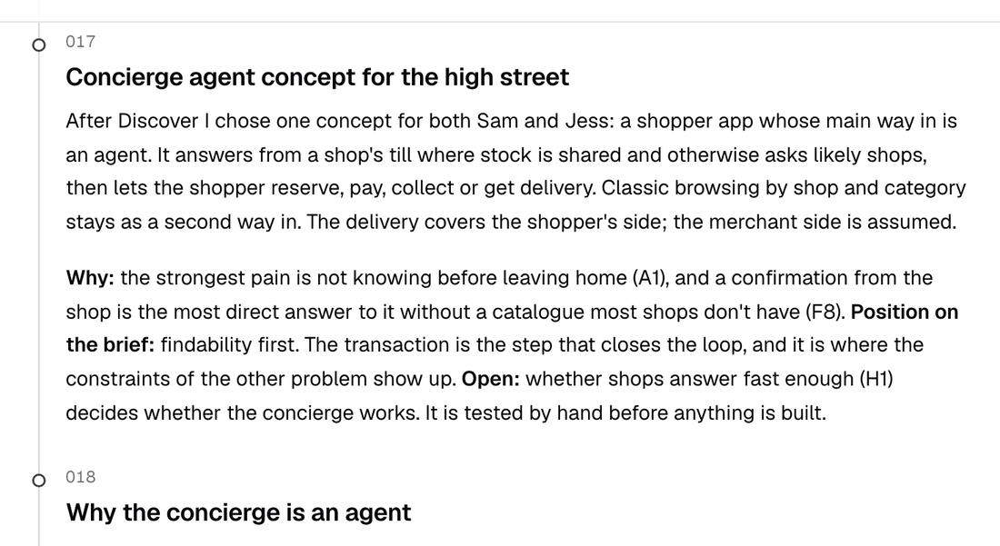

# Concept

I assume most of what a small shop sells isn't in any stock system, so the hard part is knowing whether it's there now. Snuffle is a set of agents that acts as the shopper's concierge and asks the shops on their behalf.

<b>Shoppers in the area</b>
Sam: eclipse glasses by 4pmJess: a sourdough she can collect after 6<small>and every other ask nearby</small>

ask · answers

<b>Snuffle</b>
Understands the askPicks the likely shops and asks them all at onceBrings back each answer, labelled by source

request · reply

<b>Shops within reach</b>
Broadway Chemist TillPaper &amp; Co WhatsAppRossi's Bakery WhatsApp

## How it works

Snuffle understands the ask, asks the shops through the till where the shop is connected and on WhatsApp where it isn't, and returns the answers in one chat. It sits between many shoppers and many shops at once, across every street within the shopper's reach, so nobody has to phone round.

## How the transaction shapes it

An answer only helps if the shopper can act on it in the same chat. So every answer carries the shop, the price, a collect-by date and Buy. The shopper isn't charged until the shop confirms it has set the item aside. One order is one shop, with collection as the default.

## From pains to tests

I wrote a value proposition from the pains in the empathy map, then turned the assumptions it rests on into hypotheses, each with a pass mark set before any test. A service blueprint maps each step across the shopper, Snuffle, the agents behind it and the shop. Every page in the AI context separates my call from what an agent did in that step.

Evidence: [concept](../define/index.md), [value proposition](../define/value-proposition.md), [hypotheses](../define/hypotheses.md), [service blueprint](../define/blueprint.md).

## Key decisions

| Decision | What I gave up | Log |
| --- | --- | --- |
| An agent that asks shops is the main way in; browsing comes second | A catalogue search, which needs item data most independents don't have. An asked shop takes minutes | 017, 018 |
| The request is the unit: four objects and no item pages | One chat per product or per shop. "Request" isn't a word shoppers use | 025, 039 |
| Buy, then collect: an asked shop's payment is taken when it sets the item aside | Hold, which read as a free reservation, and an unpaid reserve, where the shop carries the no-show risk. Shoppers who pay cash | 032, 037 |
| Shops answer on WhatsApp with numbered replies, with no app to install | A shop interface. Replies are rigid, and WhatsApp's 24-hour rule limits follow-ups to templates | 021, 031 |
| Snuffle looks across the shopper's area, not one high street | A tidy one-street scope. From Blythe Road six shopping streets are within a 15-minute walk | 024 |
| A proof of concept with shops before interviews | Building before I know whether shops answer | 015, 020 |

## What I assumed and left out

The assumptions with the most risk are about shops: that they answer on WhatsApp within ten minutes, and keep a bought item for about a week. No shopkeeper is in the evidence, and each assumption has a hypothesis that tests it.

I left out an interface for shops, a basket across several shops, delivery booked by Snuffle, real payments, stock and agents, and Ruth.

Evidence: [decision log](../decision-log.md).
