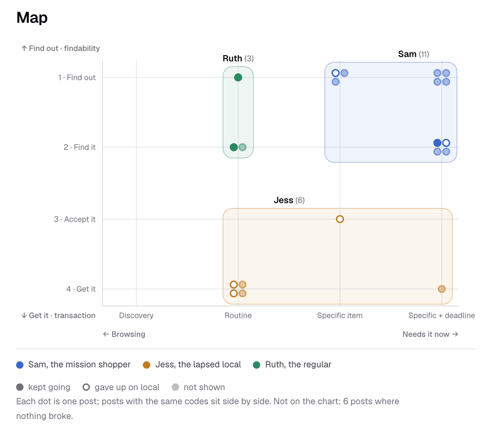

# Discovery

I'm new to London, so I worked from the outside in: what a high street is, then one street I walk every day, then what shoppers write in public. It ended with a choice, findability, with Sam as the first shopper.

<b>Desk research</b>6,969 high streets in Britain, 1,204 of them in London (ONS, 2019)

<b>Hammersmith</b>Where I live, used as the worked example

<b>Netnography</b>Public posts collected and tagged by agents, then coded blind by a second agent

<b>Empathy map and two dimensions</b>Need urgency and purchase stage

<b>Proto-personas</b>20 posts clustered: Sam 11, Jess 6, Ruth 3

<b>Benchmarks</b>17 products, their screens and their reviews

<b>Conclusion</b>10 facts, 14 assumptions, 8 open questions

## Desk research and Hammersmith

An agent researched what a high street is, how many there are, and the culture, rules and money around them. I then cut to Hammersmith, where I live, so every claim could be checked against a street I walk, and so I could look at it with an ethnographer's eye: locals use King Street for errands and send visitors to Chiswick.

Evidence: [desk research](../discover/high-street-landscape.md).

## Netnography and proto-personas

I had no user data, so I used public posts. Agents collected and tagged what London shoppers write on Reddit, Mumsnet and X, and a second agent coded the posts blind (kappa 0.85 to 0.93 on the main codes). From there came an empathy map, and after a few iterations two dimensions: how urgent the need is, and the step of buying where the attempt stopped. Plotting the posts on both showed three patterns of behaviour, which became proto-personas. They were quick to make, they rest on data, and I treat them as a direction to test.

Evidence: [netnography](../discover/netnography/method.md), [empathy map](../discover/netnography/empathy-map.md), [dimensions](../discover/netnography/dimensions.md), [proto-personas](../discover/personas/index.md).

## Benchmarks

An agent compared 17 products a London shopper can use today, with their main screens and dated reviews. Whatever the model, the complaint users repeat most is being told something was available when it wasn't. One basket across several sellers already exists online, with postal delivery.

Evidence: [benchmarks](../discover/benchmarks.md).

## What bounds the problem

- Goods paid for at a distance carry a 14-day right to cancel, except perishables such as bread and flowers, and stay at the shop's risk until collected.
- 63% of London high-street users walked there (2017), so collection on foot is realistic and delivery is the second option.
- Cash is 8% of UK payments but about a fifth of retail transactions.
- Six of the eight open questions are about shopkeepers, who are missing from the material.

Evidence: [conclusion](../discover/conclusion.md).

## The pains I chose to act on

These findings decided the product. Each comes from the discovery material, with how strong the evidence is.

| Pain | Where it came from | What it changed in the product |
| --- | --- | --- |
| Shoppers can't tell whether a nearby independent has the item, or is open, without going or asking someone | 8 of 20 clustered posts stopped there, on Reddit, Mumsnet and X (A1, high) | The shop itself answers; Snuffle asks instead of searching |
| Small shops keep little item-level stock data | No count found; fewer than 10% of micro-businesses sold online in 2019 (A14, low) | No catalogue to index, so asking is the only reliable route |
| A wrong "it's in stock" costs more trust than no answer | The complaint users repeat most across 17 benchmarked products (A10, medium) | Every answer shows its source, Snuffle never guesses, and nobody is charged until the shop sets the item aside |
| Opening hours listed online are often wrong | Posts in a Mumsnet thread and on Reddit, and map reviews (A2, medium) | Snuffle asks shops while they're open, and Nearby lists the shops open near you |
| When the need is urgent, a nearby shop beats online | Eclipse glasses, a fan in a heatwave, flowers on a Sunday (A4, medium) | The ask carries a deadline ("by 4pm"), and answers come in minutes |
| People at work during shop hours give up on local shops | 2 of Jess's 6 posts (A6, low) | Buy ahead and collect after hours, at a newsagent open until 11pm |

Evidence: [conclusion, assumptions](../discover/conclusion.md), [findings](../discover/netnography/findings.md), [benchmarks](../discover/benchmarks.md).

## The choice

Of the 20 clustered posts, 8 stopped at the first step: finding out who has the item and whether the shop is open. Five stopped at the transaction, for reasons like opening hours and cash, and none was about buying from several shops at once. I had put the choice off until after discovery (decision 001), and then chose findability (decision 017).

- Sam, the mission shopper (11 posts), needs a specific thing by a deadline. The prototype serves him first.
- Jess, the lapsed local (6 posts), works during shop hours. She comes second, buying ahead and collecting after work.
- Ruth, the regular (3 posts), keeps shopping locally while her shops close. I left her out.

Evidence: [decision log](../decision-log.md).
