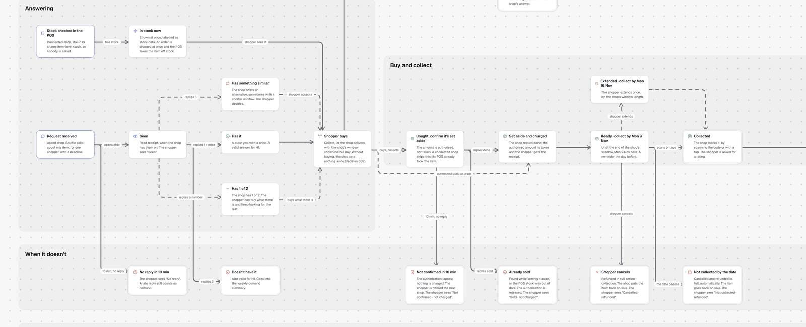
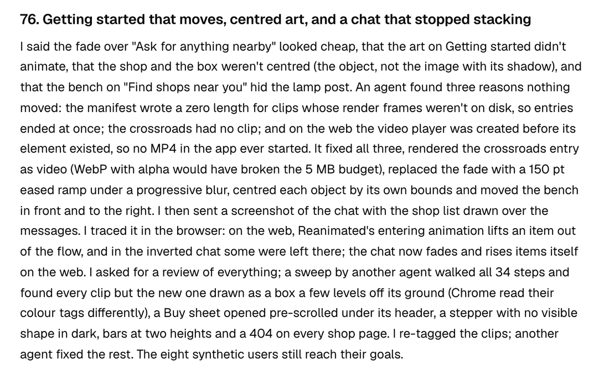

# How I built it

I directed the work and made the decisions; agents collected, coded, drafted and checked, under shared rules and review gates. Many calls came from my own repertoire: the design system, the flows, the states. They are rough in places, solid enough to build on, and each one was reviewed.

## The AI context

The AI context is everything an agent reads before it works: the rules, the research, the specs, the decisions and the logs. It is long on purpose. The more of my reasoning is written down, the more agents I can run at once without correcting their output by hand.

- One rules file, `AGENTS.md`, that every agent reads: evidence, writing, bilingual docs, review gates (decision 005).
- A main agent running subagents in parallel, and a second agent from another tool for reviews.
- Specs in OpenSpec: a short PRD, capability specs and a change per piece of work (decision 044).
- A design system written as code: tokens generate four themes, and lint, type checks and a token-drift check run on every agent edit.

```text
AGENTS.md                 rules every agent reads
openspec/
  project.md              the PRD
  specs/                  12 capabilities: request, answers, order, collection…
  changes/archive/        11 changes, one per piece of work
app/src/design-system/
  AGENTS.md               UI rules for agents
  tokens/                 DTCG tokens for iOS, Android, light and dark
  components/             59 components, the only ones screens may use
docs/                     this record, in English and Portuguese
```

## Flows and states

The first app flow came from an agent given the service blueprint and the hypotheses. I iterated it through ten versions, and every version stays in the canvas's version menu; its "About this canvas" panel lists the decisions behind it. The shop's request states and the agent flow are the base a real agent would be built on, and I kept them simple here.



Evidence: [app flow](../develop/ideation/app-flow.md), [shop request states](../develop/ideation/shop-states.md), [agent flow](../develop/ideation/agent-flow.md).

## Conceptual model and design system

I asked for a conceptual model before any more screens, so the agents' output would stay coherent with how a shopper thinks: four objects, one verb per action, one table of status labels. The design system starts from Apple's guidelines and is then customised in tokens and 59 components.

Evidence: [conceptual model](../develop/design-system/conceptual-model.md), [design system](../develop/design-system/index.md).

## Brand and illustrations

Snuffle is a dog sniffing things out. The mark began as an agent's vector tests, which I redrew by hand in Figma; apart from one scratch board for palettes, that is where Figma came in. The 3D illustrations, modelled in code and tuned in a viewer, give the app a British high-street character and act as navigation on the category tiles. Visual explorations live on canvases, where the chosen option has a green outline.

Evidence: [brand](../develop/ideation/brand.md), [mark](../develop/design-system/mark.md), [illustrations](../develop/design-system/illustrations.md), [identity](../develop/ideation/identity.md).

## Synthetic test users

Eight scripted test users, four for Sam and four for Jess, play the prototype and record where a flow breaks. They catch broken flows and edge cases. They are not users and say nothing about demand.

Evidence: [synthetic test users](../deliver/synthetic-users.md).

## One loop, start to finish

<div class="feature"><video class="phone-video" src="media/getting-started.mp4" data-poster="media/getting-started.png" width="450" height="948" aria-label="Getting started after the fix: the street scene moves, then Continue leads to the next two pages" controls muted playsinline loop preload="metadata"></video><div>

| | |
| --- | --- |
| What I asked | The fade on Getting started looked cheap, the art didn't animate, and two objects weren't centred |
| What came back | An agent found three separate reasons nothing moved, fixed them, replaced the fade and centred each object by its own bounds |
| What I did by hand | I traced the shop list drawn over the chat messages in the browser myself, and re-tagged the older clips that Chrome read off their ground |
| What it checked | A sweep by another agent walked all 34 steps; the eight test users still reached their goals |



</div></div>

Evidence: [AI log, step 76](../process/ai-log.md).

## Review gates

- A second agent coded every post blind.
- An external review found 15 problems, mostly claims more certain than their evidence (decision 019).
- A screen reviewer checks every screen; a visual critic measures contrast in light and dark.
- A code review, coherence reviews and the scripted test users.

Agents reviewing agents share blind spots. Several of the checks that mattered were mine, made by looking at the rendered screen.

## What I threw away

- A first persona draft that looked finished and was circular.
- Pastel surfaces at 1.01 to 1.04:1 against the background, before I asked for a visual critic.
- A glass shop card, measured and left out (decision 058).
- Invented walk times, replaced by real routes (decision 063).

Evidence: [AI log and its failures](../process/ai-log.md), [screen review](../develop/design-system/screen-review.md).
