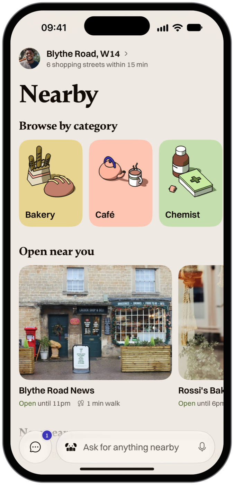
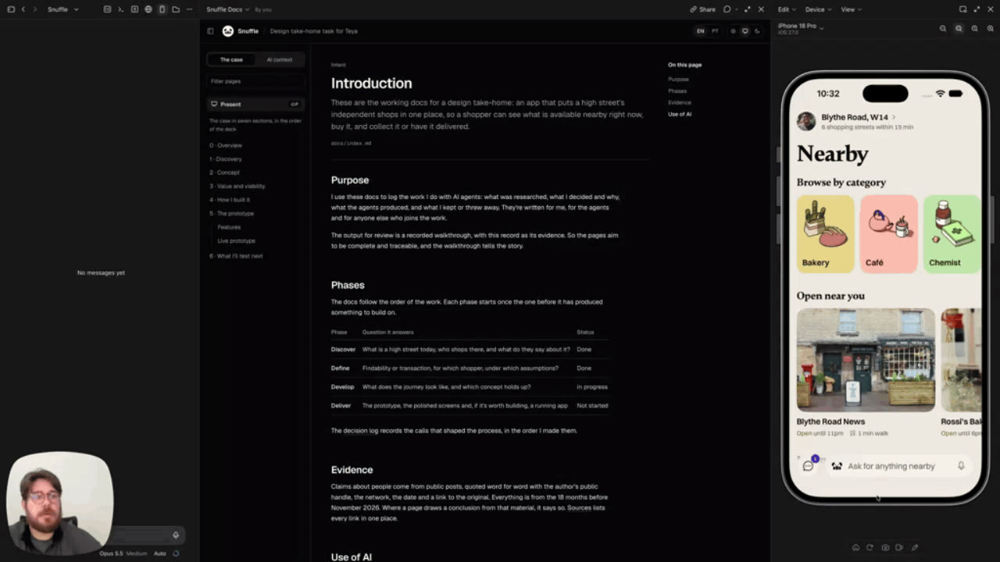

# Overview

Snuffle asks the small shops near you whether they have what you need, and you buy and collect in the same chat.

<figure class="hero-phone"><figcaption>Nearby, the home screen, rendered by iOS in the simulator.</figcaption></figure>
<figure class="loom"><a class="loom-card" href="https://www.loom.com/share/b025a90d1ff045e89efc5e36737e5980" aria-label="Watch my walkthrough of the case on Loom (opens in a new tab)"><b>Walkthrough of the case</b><small>Loom · 34 min</small></a><figcaption>My walkthrough of the case, recorded on Loom. It opens in a new tab.</figcaption></figure><ul class="dg dg-brief"><li><b>The brief</b>Bring a high street's small shops into one app, and take a position on findability or the transaction.</li><li><b>The problem</b>A shopper can't tell whether a nearby independent has the thing now, and the shop has no catalogue to search.</li><li><b>My answer</b>Snuffle asks the shops; you buy and collect in the same chat.</li><li><b>The bet</b>Shops answer within minutes while they are open. It is untested, so it is the <a href="next.md">first thing I'll test</a>.</li><li><b>How I work</b>Very little Figma. I build with AI agents in code and write every decision down as AI context, the second block in the sidebar.</li><li><b>Who and when</b>Alone, directing agents, from 1 to 6 November 2026. An Expo app, iOS first, that also runs on Android and the web.</li></ul>

## Sections

The case and the deck share these six sections, in the order I worked.

<video class="phone-video" src="media/shops-answer.mp4" data-poster="media/shops-answer.png" width="450" height="948" aria-label="Six shops move from Asked to Seen to an answer; Paper and Co, Broadway Chemist and Olympia Cameras answer with prices and Buy" autoplay muted playsinline loop preload="metadata"></video>

1. [Discovery](discovery.md): desk research, public posts, proto-personas, and the choice of findability.
2. [Concept](concept.md): the options I weighed, the concierge I chose, and what each decision gave up.
3. [Value and viability](viability.md): why it belongs inside a POS provider, with a revenue projection.
4. [How I built it](how-i-built.md): the AI context, the design system, the review gates and what I threw away.
5. [The prototype](product.md): the journey, its [features](features.md) and the [live prototype](../deliver/prototype.md).
6. [What I'll test next](next.md): the first experiment, the signals to stop or go, and what I'd do differently.

## What isn't measured yet

Nothing about demand. No shopper or shopkeeper was interviewed; the shopper evidence is 20 clustered public posts. The prototype's shops are invented and answer on a script, and the revenue figures are a projection.

Evidence: [the brief](../brief.md), [decision log](../decision-log.md).
