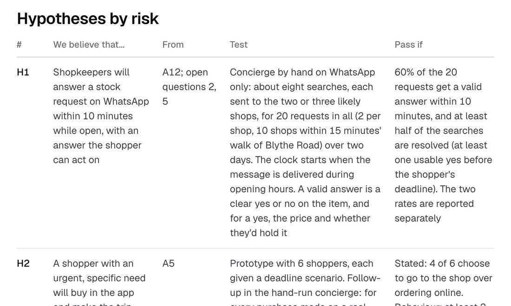

# What I'll test next

The first test is whether shops answer, by hand, before I build anything that depends on it. I set every pass mark before testing, so a result can't be read to fit.

## Measurement

Task success is the base: whether a shopper gets from the ask to an order and a collected item, and where they drop out. While the product is young I'd record events broadly, because I don't yet know which ones matter; events cost money at scale, so I'd cut them later. The plan defines 58 events and builds none of them in the prototype.

The north star is completed requests per week: requests that end with an order collected or delivered. A full week evens out the difference between weekday errands and weekend shopping. The [App flow](../develop/ideation/app-flow.md) canvas has a measurement layer (press M) that places every task, event and metric on the screen where it happens.

Evidence: [measurement plan](../verify/measurement.md), [product metrics](../verify/metrics.md).

## What I'll test first

| # | I believe that… | Pass if |
| --- | --- | --- |
| H1 | Shops answer a request on WhatsApp within 10 minutes while open | 60% of 20 requests get a valid answer in 10 minutes, and half the searches end with a usable yes before the deadline |
| H3 | Shoppers would rather ask one concierge than browse and contact shops one by one | Asking chosen first in 4 of 6 scenarios, and called simpler by 4 of 6 |
| H4 | Shoppers accept a wait of several minutes while the concierge works | 4 of 6 wait for the answer |

H1 has no evidence today, and without it the concierge doesn't work.

## First experiment

About ten independent shops within a 15-minute walk of Blythe Road, and about 20 requests over two days. An agent sends the requests on WhatsApp, six shoppers use the prototype, and the shops get a weekly demand summary. If the agent isn't ready, I play the concierge on WhatsApp myself. Inviting the shops is also the first conversation with a shopkeeper in this project.

Evidence: [hypotheses](../define/hypotheses.md), [next step](../define/next-step.md).

## Signals to stop or go

- H1, H3 and H4 pass: the concierge can be the main way in.
- H1 fails: the concept narrows to shops whose tills share stock, or to a slower request with an answer by a set time.
- H3 or H4 fails: browsing becomes the main screen, and Snuffle handles what browsing can't answer.

## What I'd do differently

I'd put a few real requests in front of shops early. The proof of concept over interviews still holds, but I finished with H1 at no evidence at all.

I'd set the visual gates before the first screen. The visual critic came after the pastel tiles measured 1.01:1, and several visual calls were reversed within days: the mark's tile, the Requests button's side, the shop card's colour.

I'd use real data wherever it was cheap. The walk times were invented until real routes replaced them, and two shops then fell outside the 20-minute radius.
