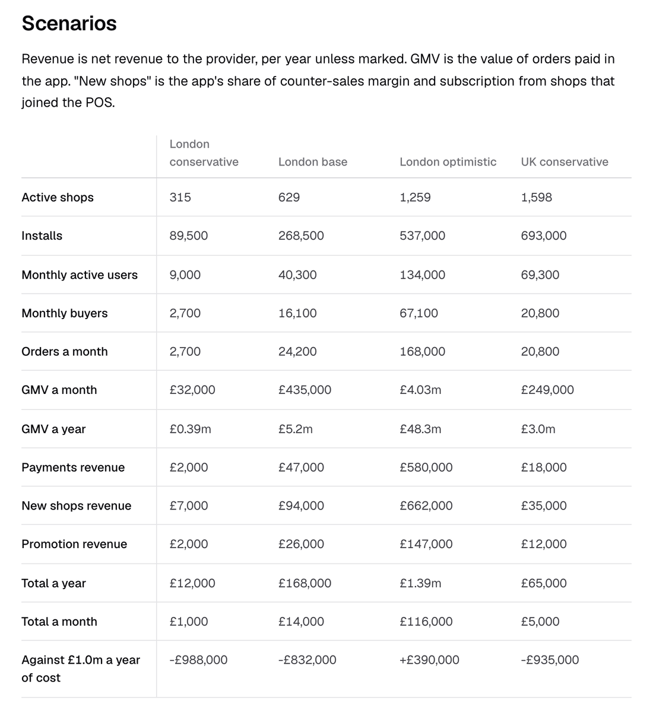

# Value and viability

My recommendation is to launch Snuffle inside a POS provider's ecosystem. On its own it would hardly pay; inside a provider it adds value at every link of the chain.

## On its own

As a standalone app built from zero, Snuffle would carry the cost of building it plus the commercial and operating cost of winning a network of shops and keeping it. To pay for that it would need a commission on the sale. Delivery apps take a reported 14 to 35%, the cost independents complain about, so I ruled one out (decision 023).

## Inside a POS provider

<b>For the shop, an acquisition channel</b>Shoppers who wouldn't have walked in, with no ads and no cut of the sale

<b>A POS that sells past the counter</b>The shop sells to someone who isn't standing in it, which is a reason to take the provider's POS and to keep it

<b>A shopper base</b>People who ask and buy nearby, paying through the provider

<b>Demand and supply by area</b>What people nearby asked for, and which shops answered, shows where to grow the network next

Revenue comes from payments made in the app, from shops joining the provider's POS to receive them (which brings their counter sales too), and from paid promotion.

Evidence: [value and revenue](../define/revenue.md).

## The estimate

An agent built an estimate from public benchmarks for a steady state about three years after launch, inside a provider. It is a projection, and nothing in it is measured.

- UK base case: about 3,200 active shops, 125,000 monthly buyers, £40m of sales a year through the app and about £1.0m of revenue a year, against a cost I assumed at £1.0m.
- London alone: about £170,000 a year. It works as a launch market and does not pay for the product by itself.
- Most of the revenue comes from shops joining the POS. In-app payments are the smallest source, about £3 of net revenue per buyer a year.

The input I trust least is how much of that joining the app causes: 30, 50 and 70% by scenario, with no source.

Evidence: [revenue estimate](../define/revenue-estimate.md).

## The cheapest test

Before an app, the cheapest test is an agent on WhatsApp or Telegram that a provider's shops promote to their own customers. The brief asks for craft, so in this take-home the shopper side is an app, while shops stay in conversation and never install anything.

## Risks

- Answers after 20 minutes are too slow for Sam's deadline.
- Too many questions a shop can't sell against, and it stops answering.
- A street with few shops answering gives few answers and no trust.
- A wrong yes, from a shop or from an agent that misreads the request, costs the trust the concept is built on.
