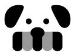
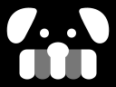
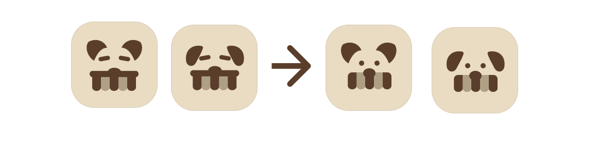
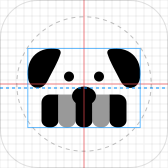
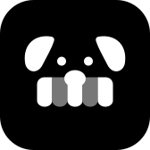
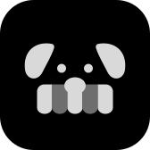
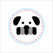

# Mark

The app's icon for now: a terrier whose mouth is a shop's awning. I drew it by hand in Figma from the agent's icon tests and chose it as the first identity decision. It is provisional: the line is settled, the drawing and the colours are not, so it is shown here in black and white.

```summary
Takeaways:
- A terrier's face with low, folded ears and two dot eyes. Its mouth is a striped awning, the kind over a shopfront, with the nose resting on it.
- Two tones: a high-contrast one for the face and three of the stripes, a low-contrast one for the other two. In black and white that is black and a mid grey.
- The agent rebuilt my drawing on one symmetry axis and centred it optically, then applied it to the iOS and Android icon formats: light, dark and tinted on iOS, adaptive and themed on Android.
Call:
- Provisional (decision 033). Black and white until the palette is chosen.
AI:
- An agent drew the icon tests in SVG from my seeds (a sniffer dog, British shopping, the parade's awnings). I took the first two into Figma and changed the vectors by hand. The agent exported my version, rebuilt it on one axis and drew the platform applications; it changed proportions only where the drawing was off-centre.
Trade-offs:
- On Android the glyph has to fit a 66 dp safe zone, so it is about half the icon's width and the stripes get thin at small sizes. A simpler version for small sizes is still open.
```

<div class="marks">
<figure><figcaption>On white</figcaption></figure>
<figure><figcaption>On black</figcaption></figure>
</div>

## From the tests to the mark

<div class="marks wide">
<figure><figcaption>My Figma board. Left of the arrow: the agent's icon tests 1 and 2. Right: my two versions; I chose the last one.</figcaption></figure>
</div>

The agent's tests had the parade's awning as a bar across the face, with stripes hanging from it and two dashes for brows. In Figma I changed the vectors myself:

| Change | Starting point |
| --- | --- |
| Removed the awning's top bar, so the stripes start right under the nose | Tests 1 and 2; with the bar, the stripes read as teeth |
| Replaced the brows with two dot eyes | The dashes in tests 1 and 2 |
| Kept the ears low and folded | Test 2; my first version had upright ears, like test 1 |
| Rested the nose on the awning | The nose sat on the bar in the tests |
| Kept two tones in the stripes | The tests' alternating stripes |

## Refinement

The agent rebuilt the drawing from the Figma vectors without changing its shapes:

| Change | Figma drawing | Rebuilt |
| --- | --- | --- |
| Symmetry axis | Three centres: eyes and nose at 85.0, ears at 85.3, awning at 85.65 (of 168) | One axis for all parts; the right ear is a mirror of the left |
| Stripes | Five stripes of 17 units, with a 0.3 unit step between the second and third | Five stripes of exactly 17 units |
| Position | Glyph centred 2.5 units below the tile's centre and 1.3 to the right | Centred horizontally and moved 4 units above centre, because the awning makes the glyph bottom-heavy |

<div class="marks">
<figure><figcaption>8-unit grid on a 168 tile. Red: the tile's centre lines. Blue dashed: the glyph's optical centre. Grey circle: 80% of the tile.</figcaption></figure>
</div>

## iOS

Apple asks for one square 1024 px image; the system applies the rounded mask, so the artwork has no corners or shadow of its own. Since iOS 18 an icon can also have a dark and a tinted version: the dark one keeps the glyph light on a dark background, and the tinted one is greyscale, which the system colours with the shopper's tint.

<div class="marks">
<figure><figcaption>Light</figcaption></figure>
<figure><figcaption>Dark</figcaption></figure>
<figure><figcaption>Tinted, in greyscale</figcaption></figure>
</div>

## Android

An adaptive icon is two 108 dp layers. Launchers show the middle 72 dp through their own mask (circle, squircle, rounded square) and may move the layers, so the glyph stays inside a 66 dp safe zone. Since Android 13, a monochrome layer lets the launcher theme the icon with the wallpaper's colours; the second tone becomes a lighter alpha of the same colour.

<div class="marks">
<figure><figcaption>108 dp canvas. Blue: 72 dp visible area. Red dashed: 66 dp safe zone.</figcaption></figure>
<figure><figcaption>Circle mask</figcaption></figure>
<figure><figcaption>Themed, monochrome layer</figcaption></figure>
</div>

## Anatomy

| Part | Shape | Tone |
| --- | --- | --- |
| Ears | Two folded ears, low on the head, mirrored | High contrast |
| Eyes | Two dots, 15 units either side of the axis | High contrast |
| Nose | An oval resting on the awning | High contrast |
| Awning | Five stripes of 17 units with rounded ends, the outer two with a rounded top corner | Stripes 1, 3 and 5 high contrast; 2 and 4 low contrast |

In the Figma version the tones were Brew #5A3E2B and #AFA085 on Oat #E9DCC3. They come back when the palette is chosen.

## Open

- A simpler version for sizes below about 29 pt.
- The colours, which follow the palette once I choose one.
- The name.
