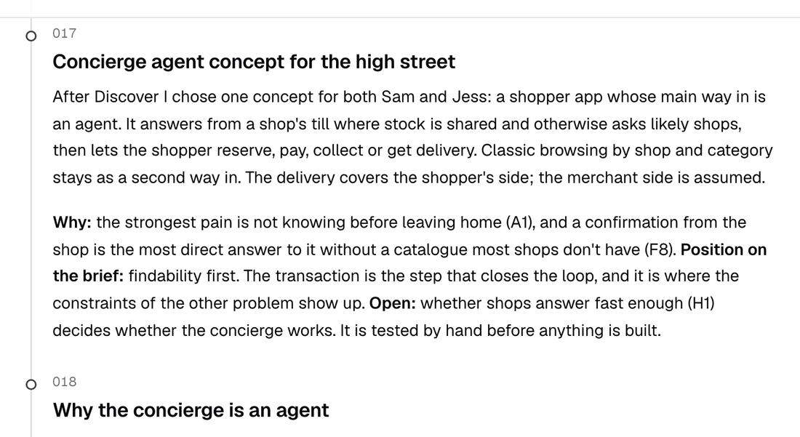

# Conceito

Suponho que a maior parte do que uma loja pequena vende não está em nenhum sistema de estoque, então a parte difícil é saber se o item está lá agora. O Snuffle é um conjunto de agentes que age como o concierge de quem compra e pergunta às lojas por ele.

<b>Compradores na área</b>
Sam: óculos para eclipse até as 16hJess: um pão de fermentação natural que ela possa retirar depois das 18h<small>e todo outro pedido por perto</small>

pedido · respostas

<b>Snuffle</b>
Entende o pedidoEscolhe as lojas prováveis e pergunta a todas de uma vezTraz cada resposta, com a fonte indicada

pergunta · resposta

<b>Lojas ao alcance</b>
Broadway Chemist CaixaPaper &amp; Co WhatsAppRossi's Bakery WhatsApp

## Como funciona

O Snuffle entende o pedido, pergunta às lojas pelo caixa quando a loja é conectada e pelo WhatsApp quando não é, e devolve as respostas numa conversa só. Ele fica entre muitos compradores e muitas lojas ao mesmo tempo, em todas as ruas ao alcance de quem compra, para que ninguém precise sair ligando.

## Como a transaction molda o conceito

Uma resposta só ajuda se quem compra puder agir sobre ela na mesma conversa. Por isso toda resposta traz a loja, o preço, uma data para retirar e Buy. O comprador só é cobrado quando a loja confirma que separou o item. Uma compra é de uma loja só, com retirada como padrão.

## Das dores aos testes

Escrevi uma proposta de valor a partir das dores do mapa de empatia, depois transformei as premissas em que ela se apoia em hipóteses, cada uma com um critério de aprovação definido antes de qualquer teste. Um blueprint de serviço mapeia cada etapa entre o comprador, o Snuffle, os agentes por trás dele e a loja. Cada página do contexto de IA separa a minha decisão do que um agente fez naquela etapa.

Evidência: [conceito](../define/index.md), [proposta de valor](../define/value-proposition.md), [hipóteses](../define/hypotheses.md), [blueprint de serviço](../define/blueprint.md).

## Decisões principais

| Decisão | O que deixei de lado | Registro |
| --- | --- | --- |
| Um agente que pergunta às lojas é a entrada principal; explorar vem em segundo | Uma busca de catálogo, que precisa de dados de item que a maioria das independentes não tem. Uma loja consultada leva minutos | 017, 018 |
| O pedido é a unidade: quatro objetos e nenhuma página de item | Uma conversa por produto ou por loja. "Pedido" não é a palavra que os compradores usam | 025, 039 |
| Comprar, depois retirar: o pagamento numa loja consultada é capturado quando ela separa o item | O Hold, que parecia uma reserva grátis, e a reserva sem pagamento, em que a loja corre o risco de ninguém aparecer. Quem paga em dinheiro vivo | 032, 037 |
| As lojas respondem no WhatsApp com respostas numeradas, sem app para instalar | Uma interface para lojas. As respostas são rígidas, e a regra de 24 horas do WhatsApp limita os acompanhamentos a templates | 021, 031 |
| O Snuffle olha a área de quem compra, não uma única high street | Um escopo arrumado de uma rua só. Da Blythe Road, seis ruas comerciais ficam a menos de 15 minutos a pé | 024 |
| Uma prova de conceito com lojas antes de entrevistas | Construir antes de saber se as lojas respondem | 015, 020 |

## O que supus e o que deixei de fora

As premissas de maior risco são sobre as lojas: que elas respondem no WhatsApp em até dez minutos e guardam um item comprado por cerca de uma semana. Nenhum lojista está na evidência, e cada premissa tem uma hipótese que a testa.

Deixei de fora uma interface para lojas, uma cesta com várias lojas, entrega agendada pelo Snuffle, pagamentos, estoque e agentes reais, e a Ruth.

Evidência: [registro de decisões](../decision-log.md).
