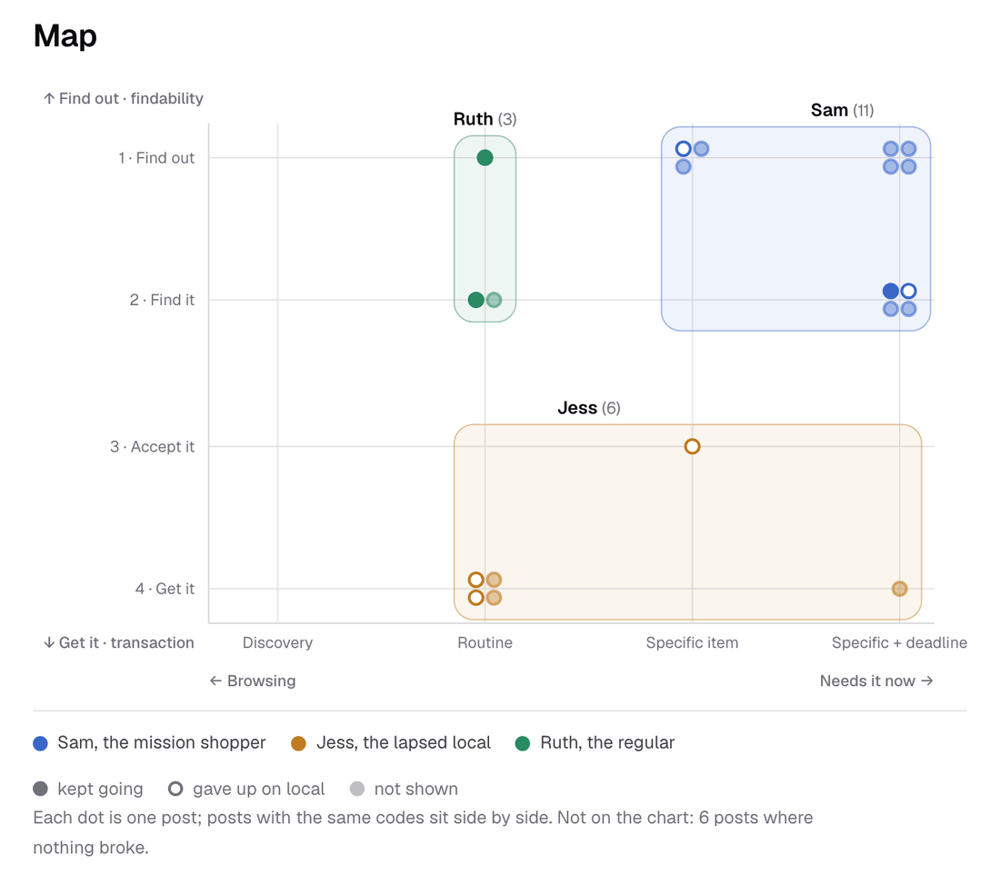

# Descoberta

Sou novo em Londres, então trabalhei de fora para dentro: o que é uma high street, a rua comercial do bairro, depois uma rua por onde passo todo dia, depois o que os compradores escrevem em público. Terminou numa escolha, findability, com o Sam como primeiro comprador.

<b>Pesquisa documental</b>6.969 high streets na Grã-Bretanha, 1.204 delas em Londres (ONS, 2019)

<b>Hammersmith</b>Onde moro, usado como exemplo trabalhado

<b>Netnografia</b>Posts públicos coletados e etiquetados por agentes, depois etiquetados às cegas por um segundo agente

<b>Mapa de empatia e duas dimensões</b>Urgência da necessidade e etapa da compra

<b>Proto-personas</b>20 posts clusterizados: Sam 11, Jess 6, Ruth 3

<b>Benchmarks</b>17 produtos, suas telas e suas avaliações

<b>Conclusão</b>10 fatos, 14 suposições, 8 perguntas em aberto

## Pesquisa documental e Hammersmith

Um agente pesquisou o que é uma high street, quantas existem, e a cultura, as regras e o dinheiro em volta delas. Depois recortei para Hammersmith, onde moro, para que cada afirmação pudesse ser conferida numa rua por onde ando, e para olhar para ela com o olhar de um etnógrafo: os moradores usam a King Street para resolver coisas e mandam visitantes para Chiswick.

Evidência: [pesquisa documental](../discover/high-street-landscape.md).

## Netnografia e proto-personas

Eu não tinha dados de usuários, então usei posts públicos. Agentes coletaram e etiquetaram o que compradores de Londres escrevem no Reddit, no Mumsnet e no X, e um segundo agente etiquetou os posts às cegas (kappa de 0,85 a 0,93 nas etiquetas principais). Daí saiu um mapa de empatia e, depois de algumas iterações, duas dimensões: quão urgente é a necessidade, e a etapa da compra em que a tentativa parou. Plotar os posts nas duas mostrou três padrões de comportamento, que viraram proto-personas. Foram rápidas de fazer, se apoiam em dados, e eu as trato como uma direção a testar.

Evidência: [netnografia](../discover/netnography/method.md), [mapa de empatia](../discover/netnography/empathy-map.md), [dimensões](../discover/netnography/dimensions.md), [proto-personas](../discover/personas/index.md).

## Benchmarks

Um agente comparou 17 produtos que um comprador de Londres pode usar hoje, com as telas principais e avaliações datadas. Seja qual for o modelo, a reclamação que os usuários mais repetem é ouvir que algo estava disponível quando não estava. Uma cesta com vários vendedores já existe online, com entrega pelo correio.

Evidência: [benchmarks](../discover/benchmarks.md).

## O que delimita o problema

- Produtos pagos a distância têm 14 dias de direito de arrependimento, exceto perecíveis como pão e flores, e ficam sob risco da loja até serem retirados.
- 63% de quem usa as high streets de Londres foi a pé (2017), então retirar a pé é realista e a entrega é a segunda opção.
- Dinheiro vivo é 8% dos pagamentos no Reino Unido, mas cerca de um quinto das transações no varejo.
- Seis das oito perguntas em aberto são sobre lojistas, que faltam no material.

Evidência: [conclusão](../discover/conclusion.md).

## As dores em que decidi atuar

Estas descobertas decidiram o produto. Cada uma vem do material da descoberta, com a força da evidência.

| Dor | De onde veio | O que mudou no produto |
| --- | --- | --- |
| Quem compra não consegue saber se uma loja independente perto tem o item, ou se está aberta, sem ir até lá ou perguntar a alguém | 8 de 20 posts agrupados pararam aí, no Reddit, no Mumsnet e no X (A1, alta) | A própria loja responde; o Snuffle pergunta em vez de buscar |
| Lojas pequenas guardam poucos dados de estoque por item | Nenhuma contagem encontrada; menos de 10% das microempresas vendiam online em 2019 (A14, baixa) | Não há catálogo para indexar, então perguntar é o único caminho confiável |
| Um "tem em estoque" errado custa mais confiança do que nenhuma resposta | A reclamação que os usuários mais repetem nos 17 produtos do benchmark (A10, média) | Toda resposta mostra a fonte, o Snuffle nunca chuta, e ninguém é cobrado até a loja separar o item |
| Os horários publicados online muitas vezes estão errados | Posts num tópico do Mumsnet e no Reddit, e avaliações em mapas (A2, média) | O Snuffle pergunta às lojas enquanto estão abertas, e o Nearby lista as lojas abertas perto de você |
| Quando a necessidade é urgente, uma loja perto ganha do online | Óculos para o eclipse, um ventilador numa onda de calor, flores num domingo (A4, média) | O pedido leva um prazo ("by 4pm"), e as respostas chegam em minutos |
| Quem trabalha no horário das lojas desiste do comércio local | 2 dos 6 posts da Jess (A6, baixa) | Comprar antes e retirar depois do horário, numa banca aberta até as 23h |

Evidência: [conclusão, suposições](../discover/conclusion.md), [achados](../discover/netnography/findings.md), [benchmarks](../discover/benchmarks.md).

## A escolha

Dos 20 posts clusterizados, 8 pararam na primeira etapa: descobrir quem tem o item e se a loja está aberta. Cinco pararam na transaction, por motivos como horário de funcionamento e dinheiro vivo, e nenhum era sobre comprar de várias lojas de uma vez. Eu tinha adiado a escolha para depois da descoberta (decisão 001), e então escolhi findability (decisão 017).

- Sam, o comprador em missão (11 posts), precisa de uma coisa específica até um prazo. O protótipo atende ele primeiro.
- Jess, a local que desistiu (6 posts), trabalha no horário das lojas. Ela vem em segundo, comprando antes e retirando depois do trabalho.
- Ruth, a frequentadora (3 posts), continua comprando no bairro enquanto as lojas dela fecham. Deixei ela de fora.

Evidência: [registro de decisões](../decision-log.md).
