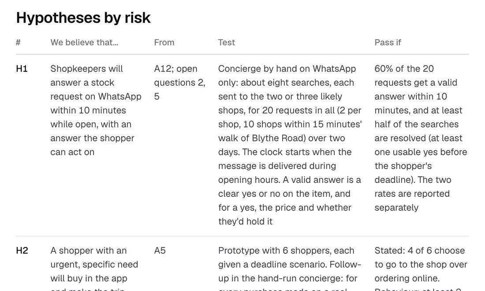

# O que vou testar a seguir

O primeiro teste é saber se as lojas respondem, à mão, antes de construir qualquer coisa que dependa disso. Defini cada critério de aprovação antes de testar, para que um resultado não possa ser lido a favor.

## Medição

O sucesso na tarefa é a base: se quem compra vai do pedido a uma compra e a um item retirado, e onde desiste. Enquanto o produto é novo, eu registraria eventos de forma ampla, porque ainda não sei quais importam; eventos custam dinheiro em escala, então eu cortaria depois. O plano define 58 eventos e não constrói nenhum no protótipo.

A métrica norte é pedidos concluídos por semana: pedidos que terminam com uma compra retirada ou entregue. Uma semana inteira equilibra a diferença entre as tarefas dos dias úteis e as compras do fim de semana. O canvas do [Fluxo do app](../develop/ideation/app-flow.md) tem uma camada de medição (tecla M) que põe cada tarefa, evento e métrica na tela onde acontece.

Evidência: [plano de medição](../verify/measurement.md), [métricas de produto](../verify/metrics.md).

## O que vou testar primeiro

| # | Acredito que… | Passa se |
| --- | --- | --- |
| H1 | As lojas respondem a um pedido no WhatsApp em até 10 minutos enquanto estão abertas | 60% de 20 pedidos recebem uma resposta válida em 10 minutos, e metade das buscas termina com um sim utilizável antes do prazo |
| H3 | Os compradores preferem perguntar a um concierge do que explorar e contatar lojas uma a uma | Perguntar escolhido primeiro em 4 de 6 cenários, e considerado mais simples por 4 de 6 |
| H4 | Os compradores aceitam esperar alguns minutos enquanto o concierge trabalha | 4 de 6 esperam a resposta |

A H1 não tem evidência hoje, e sem ela o concierge não funciona.

## Primeiro experimento

Cerca de dez lojas independentes a menos de 15 minutos a pé da Blythe Road, e cerca de 20 pedidos em dois dias. Um agente manda os pedidos no WhatsApp, seis compradores usam o protótipo e as lojas recebem um resumo semanal de demanda. Se o agente não estiver pronto, eu mesmo faço o papel do concierge no WhatsApp. Convidar as lojas também é a primeira conversa com um lojista neste projeto.

Evidência: [hipóteses](../define/hypotheses.md), [próximo passo](../define/next-step.md).

## Sinais para parar ou seguir

- H1, H3 e H4 passam: o concierge pode ser a entrada principal.
- H1 falha: o conceito se estreita para lojas cujo caixa compartilha estoque, ou para um pedido mais lento com resposta até um horário definido.
- H3 ou H4 falha: explorar vira a tela principal, e o Snuffle cuida do que explorar não responde.

## O que eu faria diferente

Eu colocaria alguns pedidos reais na frente das lojas cedo. A prova de conceito no lugar de entrevistas continua de pé, mas terminei com a H1 sem evidência nenhuma.

Eu definiria as etapas de revisão visual antes da primeira tela. O crítico visual chegou depois que os blocos pastel mediram 1,01:1, e várias decisões visuais foram revertidas em poucos dias: o fundo da marca, o lado do botão Requests, a cor do cartão de loja.

Eu usaria dados reais sempre que fosse barato. Os tempos de caminhada eram inventados até as rotas reais os substituírem, e duas lojas então ficaram fora do raio de 20 minutos.
