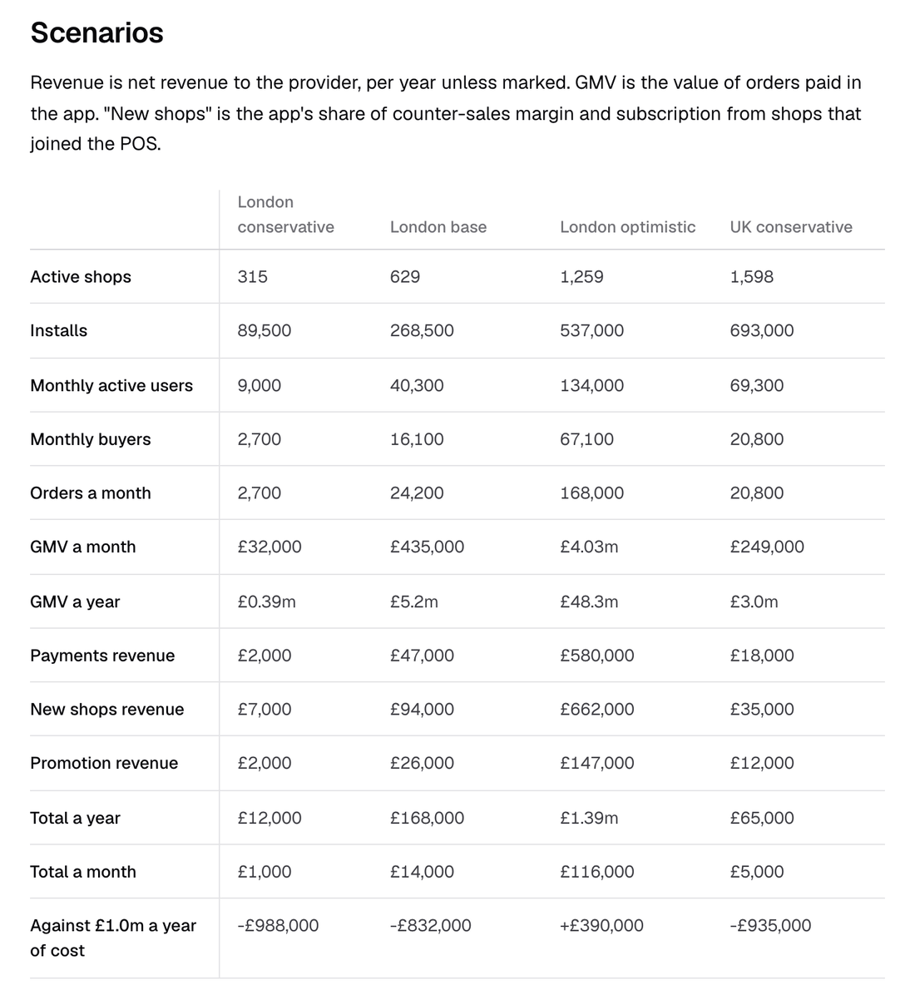

# Valor e viabilidade

Minha recomendação é lançar o Snuffle dentro do ecossistema de um provedor de POS. Sozinho, ele mal se pagaria; dentro de um provedor, ele gera valor em cada elo da cadeia.

## Sozinho

Como um app independente construído do zero, o Snuffle carregaria o custo de ser construído, mais o custo comercial e operacional de conquistar uma rede de lojas e mantê-la. Para pagar isso, ele precisaria de uma comissão sobre a venda. Apps de entrega cobram uma comissão relatada de 14 a 35%, o custo de que as independentes reclamam, então descartei comissão (decisão 023).

## Dentro de um provedor de POS

<b>Para a loja, um canal de aquisição</b>Compradores que não teriam entrado, sem anúncio e sem parte da venda

<b>Um POS que vende além do balcão</b>A loja vende para quem não está dentro dela, o que é um motivo para adotar o POS do provedor e continuar com ele

<b>Uma base de compradores</b>Pessoas que pedem e compram por perto, pagando pelo provedor

<b>Demanda e oferta por área</b>O que as pessoas por perto pediram, e quais lojas responderam, mostra onde crescer a rede em seguida

A receita vem dos pagamentos feitos no app, das lojas que entram no POS do provedor para recebê-los (o que traz junto as vendas de balcão) e do destaque pago.

Evidência: [valor e receita](../define/revenue.md).

## A estimativa

Um agente montou uma estimativa a partir de benchmarks públicos, para um estado estável cerca de três anos depois do lançamento, dentro de um provedor. É uma projeção, e nada nela foi medido.

- Cenário base no Reino Unido: cerca de 3.200 lojas ativas, 125.000 compradores por mês, £40 milhões em vendas por ano pelo app e cerca de £1,0 milhão de receita por ano, contra um custo que supus em £1,0 milhão.
- Só Londres: cerca de £170.000 por ano. Serve como mercado de lançamento e não paga o produto sozinha.
- A maior parte da receita vem das lojas que entram no POS. Os pagamentos no app são a menor fonte, cerca de £3 de receita líquida por comprador por ano.

A entrada em que menos confio é quanto dessa adesão o app causa: 30, 50 e 70% conforme o cenário, sem fonte.

Evidência: [estimativa de receita](../define/revenue-estimate.md).

## O teste mais barato

Antes de um app, o teste mais barato é um agente no WhatsApp ou no Telegram que as lojas de um provedor divulgam para os próprios clientes. O brief pede acabamento, então neste take-home o lado de quem compra é um app, enquanto as lojas ficam na conversa e nunca instalam nada.

## Riscos

- Respostas depois de 20 minutos são lentas demais para o prazo do Sam.
- Perguntas demais sobre o que a loja não pode vender, e ela para de responder.
- Uma rua com poucas lojas respondendo dá poucas respostas e nenhuma confiança.
- Um sim errado, de uma loja ou de um agente que entende mal o pedido, custa a confiança em que o conceito se apoia.
