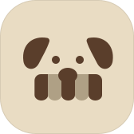

# Marca

O ícone do app por enquanto: um terrier cuja boca é o toldo de uma loja. Eu o desenhei à mão no Figma a partir dos testes de ícone do agente e o escolhi como a primeira decisão de identidade. Ele é provisório: a linha está definida, o desenho e as cores não.

```summary
Takeaways:
- O rosto de um terrier com orelhas dobradas e baixas e dois olhos em ponto. A boca é um toldo listrado, como os que ficam sobre as vitrines, com o nariz apoiado nele.
- Dois tons: um de mais contraste para o rosto e três das listras, e um de menos contraste para as outras duas listras. Sobre o Oat, são o Brew e um Brew mais apagado.
- Ele junta duas direções do quadro de identidade: o terrier que entra nas lojas e os toldos da parade.
Call:
- Provisório (decisão 033). As cores seguem Oat e Brew por enquanto; a paleta continua em aberto.
AI:
- Um agente desenhou os testes de ícone em SVG a partir das minhas sementes (um cão farejador, as compras britânicas, os toldos da parade). Levei os dois primeiros para o Figma e ajustei os vetores à mão: orelhas mais baixas, as sobrancelhas trocadas por dois olhos, o toldo embaixo do nariz. O agente exportou esta versão do Figma.
Trade-offs:
- As listras continuam legíveis no tamanho de ícone do app, mas se misturam abaixo de uns 29 pt, onde pode ser preciso uma versão mais simples.
```



## Anatomia

| Parte | Forma | Tom |
| --- | --- | --- |
| Orelhas | Duas orelhas dobradas, baixas na cabeça | Mais contraste, Brew #5A3E2B |
| Olhos | Dois pontos | Mais contraste |
| Nariz | Um oval apoiado no toldo | Mais contraste |
| Toldo | Cinco listras com pontas arredondadas, cantos de cima retos nas duas de fora | Listras 1, 3 e 5 com mais contraste; 2 e 4 com menos contraste, #AFA085 |
| Base | Formato de ícone de app do iOS, raio de 45 px em 168 px | Oat #E9DCC3, com uma borda fina de 8% de preto |

## Em aberto

- O desenho final: proporções das orelhas e do toldo, e uma versão simplificada para tamanhos pequenos.
- As cores, que seguem a paleta quando eu escolher uma.
- O nome.
